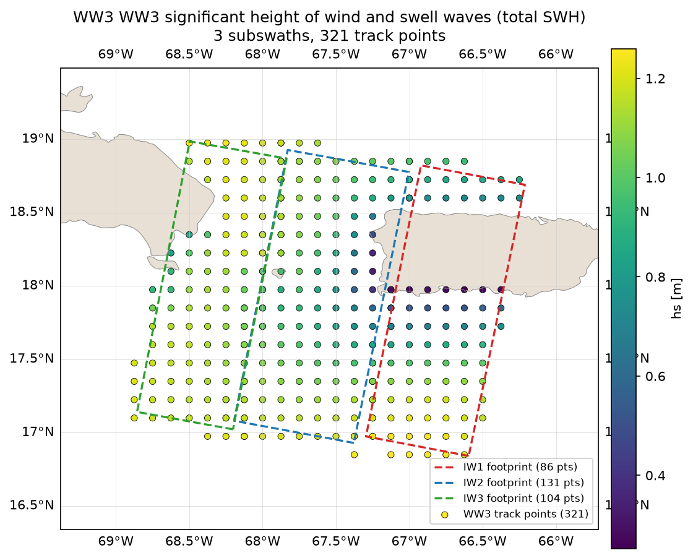

.. _l2c_definition:

File Naming Convention & L2C Product Definition
================================================

This section defines the Level-2C (L2C) product generated by ``topsocnww3sp``.

Product Definition
------------------

The L2C product is a NetCDF file that co-localizes Sentinel-1 Ocean Waves (OSW) data with WaveWatch III (WW3) spectral data. The goal is to provide a dataset where SAR observations and model spectra are aligned in time and space for easier comparison and analysis.

L2C Output Structure
---------------------

The output files use NetCDF groups to separate different types of information:

* **SAR Groups**: Contain the original OSW data (e.g., ``SAR_intraburst``, ``SAR_interburst``).
* **WW3 Group**: Contains the associated WW3 spectra. The group name depends on the mode:
    * In ``lasso`` mode, it is simply named ``WW3``.
    * In other modes, it is often prefixed by the SAR group (e.g., ``WW3_intraburst``).
* **MATCH_MAP Groups**: (Used in 1to1, unique, and many modes) Contains mapping information such as distances and pointers from SAR tiles to WW3 spectra.

WW3 Integrated Parameters
-------------------------

In addition to the 2-D wave spectrum (``efth``) and the forcing metadata, the
``WW3`` group carries the WW3 **integrated (field) parameters** sampled from
the WW3 FIELD files. Each spectrum is associated with exactly one value per
integrated parameter, on the **same dimension** as the spectra (``sample`` in
lasso mode, ``all_tiles``/``unique_ww3`` in the other modes), so a user can
read, for every WW3 spectrum, its corresponding significant wave height and
periods directly.

The variables included are data-driven by the ``ww3_field_variables`` config
list. The WW3 FIELD variable name is **preserved** as the product variable
name (``hs`` stays ``hs``), so a user reading the product finds the same
names as in the WW3 FIELD files. With the default configuration the product
may contain, depending on what the FIELD files carry:

* ``hs``: total significant wave height (m)
* ``vtm02``: mean wave period from the second-order moment (s)
* ``vtm01``: zero-crossing mean wave period (s)

Partitioned quantities (e.g. wind-sea / swell) are added the same way once the
upstream WW3 FIELD output provides them. The ``MAPSTA`` field is intentionally
excluded. All variables carry CF ``long_name``/``units``/``standard_name``
attributes. When a FIELD file or a matching grid point / time is unavailable,
the corresponding value is set to NaN (the product is never failed).

The figure below shows ``hs`` (sampled from the WW3 FIELD files) plotted on a
geographic map alongside the SAR subswath footprint, for one subswath of a
lasso product:

   WW3 significant wave height (``hs``) sampled at the WW3 track points within
   the buffered SAR subswath footprint (lasso mode).

File Naming Convention
----------------------

The output files are named following this pattern:

``<original_osw_stem>_<product_version>.nc``

Example: ``s1a-iw1-osw-vv-20220107t062429-20220107t062500-041351-04ea80-001_v0.1.nc``

The files are organized in a hierarchical directory structure:
``<output_dir>/<year>/<month>/<day>/<safe_name>/<filename>.nc``

Metadata
--------

Every L2C file contains comprehensive global attributes following CF-1.8 conventions, including the processor version, source SAR product, and the co-localization mode used.
