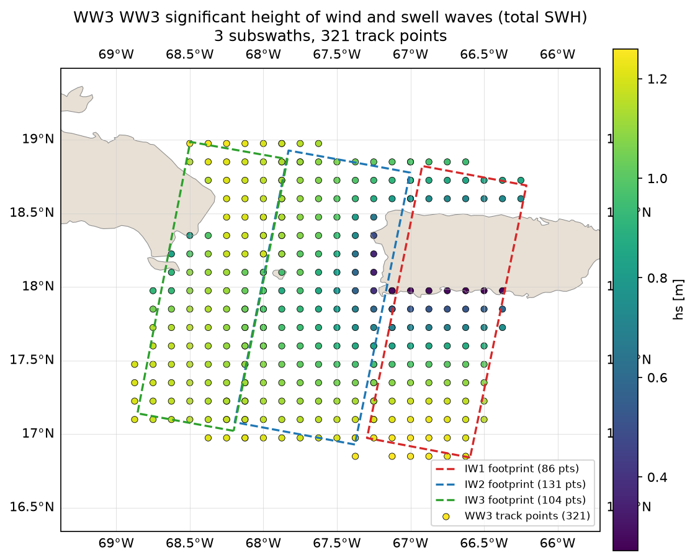

.. _l2c_definition:

File Naming Convention & L2C Product Definition
================================================

This section defines the Level-2C (L2C) product generated by ``topsocnww3sp``.

Product Definition
------------------

The L2C product is a NetCDF file that co-localizes Sentinel-1 Ocean Waves (OSW) data with WaveWatch III (WW3) spectral data. The goal is to provide a dataset where SAR observations and model spectra are aligned in time and space for easier comparison and analysis.

L2C Output Structure
---------------------

The output files use NetCDF groups to separate different types of information:

* **SAR Groups**: Contain the original OSW data (``intraburst``, ``interburst``: same names as in the ESA OSW files).
* **WW3 Group**: Contains the associated WW3 spectra. The group name depends on the mode:
    * In ``lasso`` mode, it is simply named ``WW3``.
    * In other modes, it is often prefixed by the SAR group (e.g., ``WW3_intraburst``).
* **MATCH_MAP Groups**: (Used in 1to1, unique, and many modes) Contains mapping information such as distances and pointers from SAR tiles to WW3 spectra.

WW3 Integrated Parameters
-------------------------

Besides the 2-D wave spectra (``efth``) and the forcing values stored with them
(``dpt``, ``wnd``, ``wnddir``, ``cur``, ``curdir``, ``ust``, ``ast``), the
``WW3`` group holds **integrated parameters**. Every one of them is on the
**same dimension as the spectra** (``sample`` in lasso mode, ``all_tiles`` /
``unique_ww3`` in the other modes): there is exactly one value per WW3
spectrum, so the integrated parameters follow the same lasso selection as the
spectra and users can combine them with the SAR tiles as they wish (see
:ref:`l2c_output_usage`). There is **no** value per SAR tile.

Two WW3 outputs are used, which do not share the same points:

* **TRACK files** (``*_trck.nc``): the spectra, written by WW3 at the positions
  and times requested by the track file (built from the SAR tiles);
* **FIELD files**: hourly maps on the model grid (polar stereographic ~15 km
  grids ``ARC`` / ``ANTARC``, regular 0.125 degree ``IRIGLOB`` grid between
  35S and 35N).

.. list-table::
   :header-rows: 1
   :widths: 18 12 70

   * - Variable
     - Units
     - Definition
   * - ``hs_spec``
     - m
     - Significant wave height integrated from the spectrum,
       :math:`4\sqrt{m_0}`
   * - ``tm02_spec``
     - s
     - Mean period :math:`T_{m02} = \sqrt{m_0 / m_2}`
   * - ``tm0m1_spec``
     - s
     - Mean (energy) period :math:`T_{m0,-1} = m_{-1} / m_0`
   * - ``hs``
     - m
     - Total significant wave height from the WW3 FIELD files
   * - ``ice``
     - 1
     - Sea ice area fraction (WW3 forcing) from the WW3 FIELD files

**Spectral parameters** (``*_spec``) are computed from the frequency moments of
each spectrum,

.. math::

   m_n = \sum_f \sum_\theta f^n \, E(f, \theta) \, \Delta f \, \Delta\theta ,

with :math:`\Delta f` = ``frequency2 - frequency1`` and
:math:`\Delta\theta = 2\pi / N_{directions}`. They answer the DLR request
for Tm02 and Tm0,-1, which the IRI FIELD files do not provide. Partitioned
parameters (wind sea / swells) are not provided: they would require a
partitioning of the spectra.

**FIELD parameters** (``hs``, ``ice``) are sampled, for each spectrum, from the
FIELD file of the grid the spectrum comes from (``ww3_grid_provenance``) at the
**nearest grid node** (at most ``ww3_field_max_distance_deg``, default 0.25
degree) and the **nearest hourly time step** (at most
``TIME_THRESHOLD_MINUTES``); NaN otherwise. ``hs`` and ``hs_spec`` agree to a
few millimetres (the FIELD ``hs`` is integrated over the same spectral
discretisation), ``hs`` is kept for traceability with the WW3 FIELD outputs.
The list of FIELD variables is set by ``ww3_field_variables`` in the
configuration and the FIELD variable name is preserved in the product.

All variables carry CF ``long_name`` / ``units`` / ``standard_name``
attributes; a missing FIELD file or matching node never fails the product.

The figure below shows ``hs`` (sampled from the WW3 FIELD files) plotted on a
geographic map alongside the SAR subswath footprints, for all the subswaths of
a lasso product:

   WW3 significant wave height (``hs``) sampled at the WW3 track points of all
   subswaths, each within its buffered SAR subswath footprint (lasso mode).

File Naming Convention
----------------------

The output files are named following this pattern:

``<original_osw_stem>_<product_version>.nc``

Example: ``s1a-iw1-osw-vv-20220107t062429-20220107t062500-041351-04ea80-001_v0.2.nc``

The files are organized in a hierarchical directory structure:
``<output_dir>/<year>/<month>/<day>/<safe_name>/<filename>.nc``

Metadata
--------

Every L2C file contains comprehensive global attributes following CF-1.8 conventions, including the processor version, source SAR product, and the co-localization mode used.
